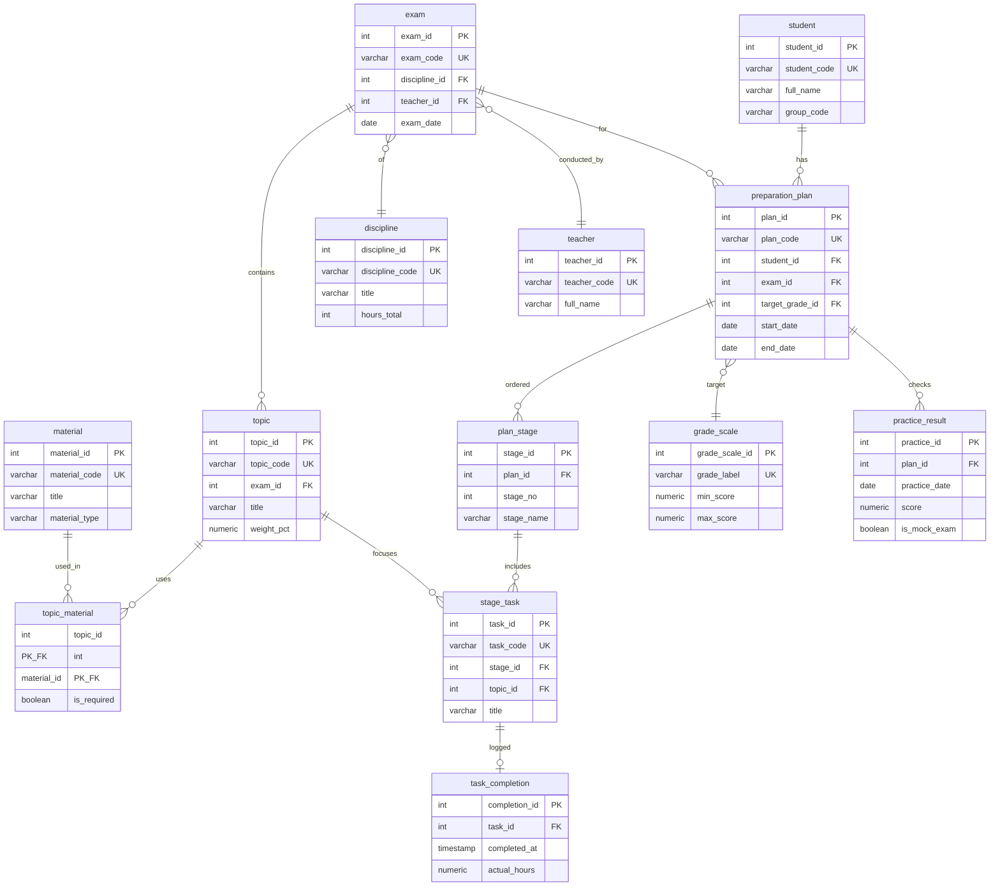

# Даталогическая модель 3NF (вариант 1)

**Предметная область:** порядок подготовки к экзамену с целью получить отличную оценку.  
**СУБД:** PostgreSQL, схема `n3nf`.  
**DDL:** [sql/01_create_3nf.sql](../sql/01_create_3nf.sql).

## Назначение модели

Операционная (OLTP-подобная) модель хранит актуальные сущности процесса подготовки: кто готовится, к какому экзамену, по каким темам и материалам, какие этапы и задания запланированы, что уже выполнено и какие результаты пробных проверок получены.

## Обоснование 3NF

1. **1NF** — все атрибуты атомарны (нет массивов и составных значений в одном поле).
2. **2NF** — нет частичных зависимостей от составного ключа: таблицы с составным PK (`topic_material`) содержат только атрибуты, зависящие от всей пары ключей.
3. **3NF** — нет транзитивных зависимостей: название дисциплины не хранится в `exam`, а берётся через `discipline_id`; целевая оценка не денормализована в план, а ссылается на `grade_scale`.

## Сущности

| Таблица | Ключ | Описание |
|--------|------|----------|
| `student` | `student_id` / `student_code` | Студент |
| `discipline` | `discipline_id` / `discipline_code` | Дисциплина |
| `teacher` | `teacher_id` / `teacher_code` | Преподаватель |
| `grade_scale` | `grade_scale_id` / `grade_label` | Шкала оценок (в т.ч. «отлично») |
| `exam` | `exam_id` / `exam_code` | Экзамен (дисциплина + преподаватель + дата) |
| `topic` | `topic_id` / `topic_code` | Тема экзамена |
| `material` | `material_id` / `material_code` | Учебный материал |
| `topic_material` | `(topic_id, material_id)` | Связь тема–материал |
| `preparation_plan` | `plan_id` / `plan_code` | План подготовки студента к экзамену |
| `plan_stage` | `stage_id` | Этап плана (порядок подготовки) |
| `stage_task` | `task_id` / `task_code` | Задание на этапе |
| `task_completion` | `completion_id` | Факт выполнения задания |
| `practice_result` | `practice_id` | Результат самопроверки / пробного экзамена |

## ER-диаграмма

## Типовой порядок подготовки (логический процесс)

1. Студент создаёт `preparation_plan` на экзамен с целевой оценкой «отлично» (`grade_scale`).
2. План разбивается на упорядоченные `plan_stage` (теория, практика, пробный, повторение).
3. На этапах задаются `stage_task`, при необходимости привязанные к `topic` и обеспеченные `material`.
4. Выполнение фиксируется в `task_completion`, прогресс по баллам — в `practice_result`.
