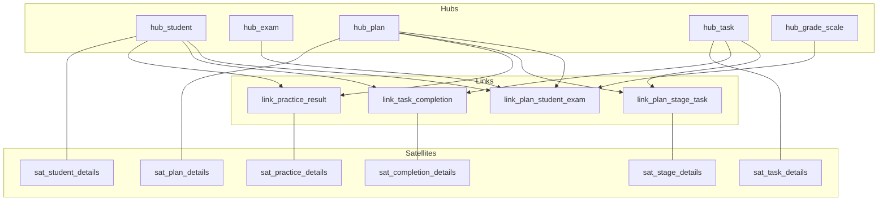

# Даталогическая модель Data Vault (вариант 1)

**Предметная область:** порядок подготовки к экзамену с целью получить отличную оценку.  
**СУБД:** PostgreSQL, схема `dv`.  
**DDL:** [sql/02_create_data_vault.sql](../sql/02_create_data_vault.sql).  
**Опора:** [Все о Data Vault (DWH-Club)](http://www.dwh-club.com/ru/dwh-bi-articles/vse-o-data-vault.html).

## Принципы

| Компонент | Что хранит | Метаданные |
|-----------|------------|------------|
| **Hub** | Уникальный бизнес-ключ сущности | `load_dts`, `record_source` |
| **Link** | Связь между двумя и более хабами | `load_dts`, `record_source` |
| **Satellite** | Описывающие атрибуты Hub или Link | `load_dts`, `hashdiff`, `record_source` |

- Hash-ключ (`hk_*`, тип `BYTEA`) вычисляется от бизнес-ключа (например, `digest(bk, 'sha256')`).
- Атрибуты **не** хранятся в Hub/Link — только в Satellite.
- История изменений: только `INSERT` новой версии Satellite с новым `load_dts` (без UPDATE/DELETE описательных полей).

## Список объектов

### Hubs

| Таблица | Бизнес-ключ | Соответствие 3NF |
|--------|-------------|------------------|
| `hub_student` | `bk_student` | `n3nf.student.student_code` |
| `hub_discipline` | `bk_discipline` | `n3nf.discipline.discipline_code` |
| `hub_teacher` | `bk_teacher` | `n3nf.teacher.teacher_code` |
| `hub_exam` | `bk_exam` | `n3nf.exam.exam_code` |
| `hub_topic` | `bk_topic` | `n3nf.topic.topic_code` |
| `hub_material` | `bk_material` | `n3nf.material.material_code` |
| `hub_plan` | `bk_plan` | `n3nf.preparation_plan.plan_code` |
| `hub_task` | `bk_task` | `n3nf.stage_task.task_code` |
| `hub_grade_scale` | `bk_grade_scale` | `n3nf.grade_scale.grade_label` |

### Links

| Таблица | Связывает | Соответствие 3NF |
|--------|-----------|------------------|
| `link_exam_discipline_teacher` | exam + discipline + teacher | `exam` |
| `link_exam_topic` | exam + topic | `topic.exam_id` |
| `link_topic_material` | topic + material | `topic_material` |
| `link_plan_student_exam` | plan + student + exam + grade | `preparation_plan` |
| `link_plan_stage_task` | plan + task | `plan_stage` + `stage_task` |
| `link_task_topic` | task + topic | `stage_task.topic_id` |
| `link_task_completion` | task + student | `task_completion` |
| `link_practice_result` | plan + student | `practice_result` |

### Satellites

| Таблица | Родитель | Атрибуты (из 3NF) |
|--------|----------|-------------------|
| `sat_student_details` | hub_student | full_name, email, group_code |
| `sat_discipline_details` | hub_discipline | title, hours_total |
| `sat_teacher_details` | hub_teacher | full_name, department |
| `sat_exam_details` | hub_exam | exam_date, max_score, location |
| `sat_topic_details` | hub_topic | title, weight_pct, sort_order |
| `sat_material_details` | hub_material | title, material_type, url_or_ref, estimated_hours |
| `sat_grade_scale_details` | hub_grade_scale | min_score, max_score |
| `sat_plan_details` | hub_plan | start_date, end_date, status |
| `sat_topic_material_details` | link_topic_material | is_required |
| `sat_stage_details` | link_plan_stage_task | stage_no, stage_name, planned_hours, description |
| `sat_task_details` | hub_task | title, due_date, planned_hours, priority |
| `sat_completion_details` | link_task_completion | completed_at, actual_hours, note |
| `sat_practice_details` | link_practice_result | practice_date, score, max_score, is_mock_exam, comment |

## Диаграмма (фрагмент ядра)

## Сравнение с 3NF

| Критерий | 3NF (`n3nf`) | Data Vault (`dv`) |
|----------|--------------|-------------------|
| Назначение | Операционный учёт процесса подготовки | Интеграционный слой хранилища |
| Изменение атрибутов | UPDATE текущей строки | Новая версия в Satellite |
| Связи | FK в дочерних таблицах | Отдельные Link-таблицы |
| Запросы «как есть» | Простые JOIN | Больше JOIN (Hub + Sat + Link) |
| Аудит источника | Обычно нет | `record_source` / `load_dts` на каждой записи |

Для лабораторной достаточно DDL и даталогических моделей; ETL-загрузка из `n3nf` в `dv` не входит в объём работы.
